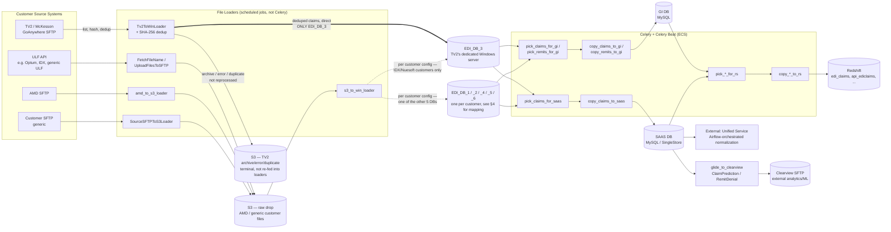
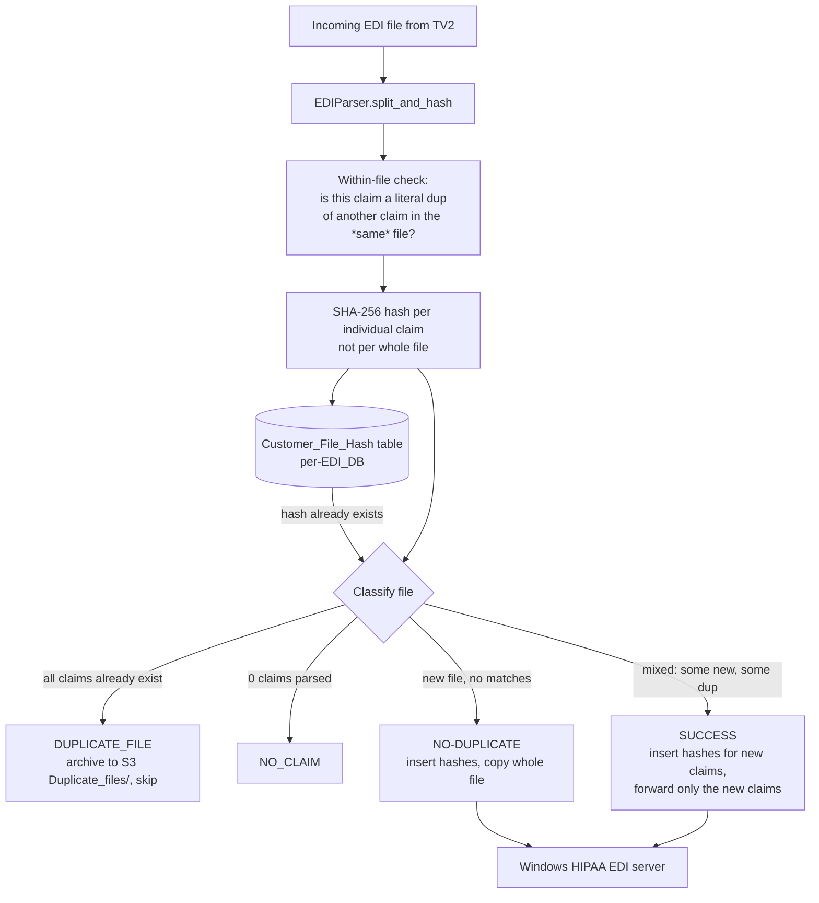
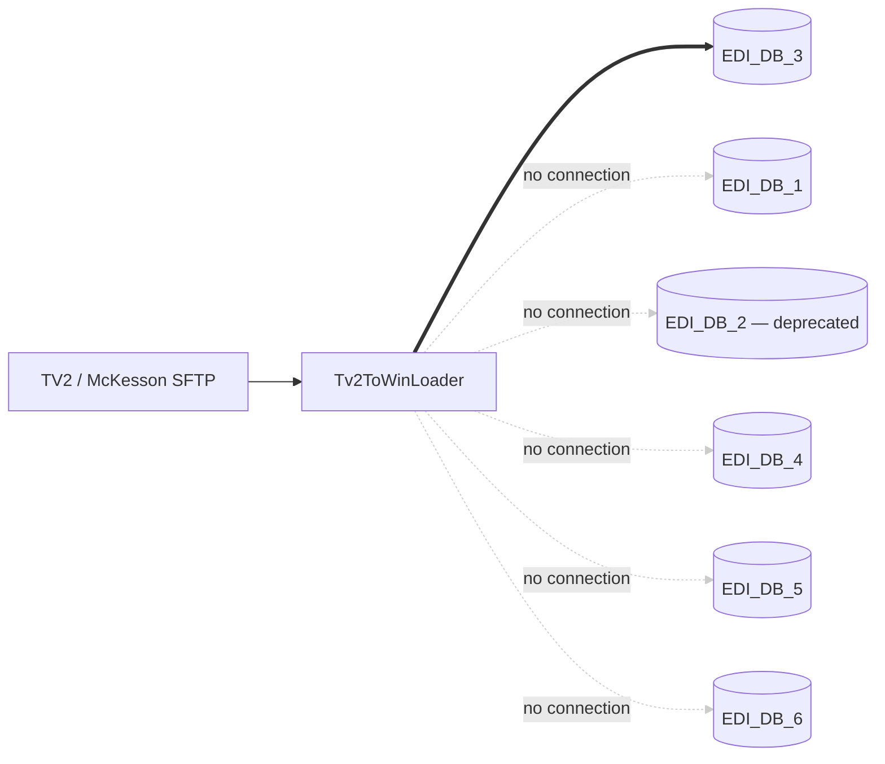
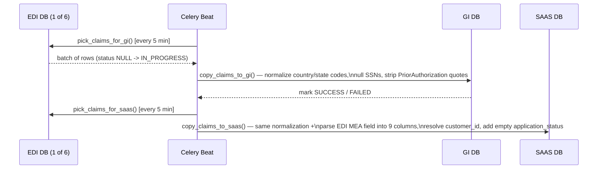
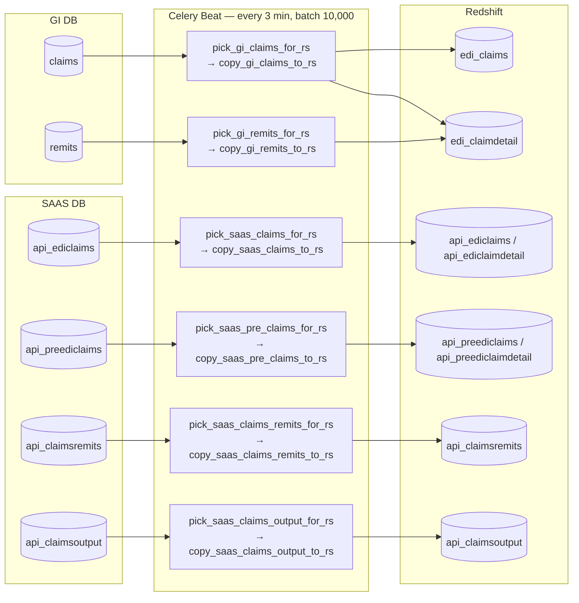
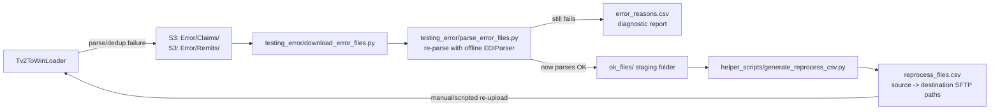

# Glide Data Pipeline — End-to-End Overview (for QA)

This document explains how claims/remittance data flows from customer source systems all the way to Redshift and the downstream Clearview analytics export. It's meant as an onboarding map for QA — not a replacement for the code-level docs in `glide-health-data-pipeline-v2/docs/`.

> Source of truth for anything below: `glide-health-data-pipeline-v2/src/`. This doc summarizes it; when in doubt, read the code.

---

## 1. The big picture



**Read it as five stages:**

1. **Ingestion** — files land in S3 from four possible source types (ULF API, AMD, TV2/GoAnywhere, generic customer SFTP).
2. **Dedup + hand-off to EDI servers** — TV2 files are hashed, deduped, and pushed specifically to **`EDI_DB_3`** (the Windows server that hosts TV2/McKesson customers). It's one of **6 sharded MySQL "EDI DBs"** in total, each living on its own Windows server running third-party HIPAA EDI parsing software (this 3rd-party software turns raw 837/835 into `EDI_Claims` / `EDI_ClaimPayment` etc.).
3. **Celery pick/copy** — Celery Beat runs scheduled tasks that "pick" rows out of the EDI DBs and "copy" them into the GI DB and SAAS DB, normalizing along the way.
4. **Redshift landing** — a second pick/copy layer moves GI + SAAS rows into Redshift for analytics.
5. **Downstream export** — SAAS DB data feeds the external Unified Service (claim normalization, via Airflow) and the `glide_to_clearview` pipelines (SFTP export to Clearview).

---

## 2. Ingestion sources in detail

All ingestion jobs live in `glide-health-data-pipeline-v2/src/scripts/file_loaders/` and are **scheduled jobs, not Celery tasks** (they run as their own entrypoints).

| Source                                          | Loader                                                                                                   | What it does                                                                                                                                                                                                |
| ----------------------------------------------- | -------------------------------------------------------------------------------------------------------- | ----------------------------------------------------------------------------------------------------------------------------------------------------------------------------------------------------------- |
| **ULF API** (Optum, IDX, generic ULF customers) | `fetch_835_837_filenames.py` (`FetchFileName`) + `upload_835_837_files_to_sftp.py` (`UploadFilesToSFTP`) | Polls the ULF `payers/837`/`payers/835` list API using a persisted cursor (`ChangePointer`), records new filenames, then downloads file content and uploads it to the target SFTP claim/remit drop folders. |
| **AMD**                                         | `amd_to_s3_loader.py`                                                                                    | AMD SFTP → S3.                                                                                                                                                                                              |
| **TV2 / McKesson (GoAnywhere SFTP)**            | `tv2_to_win_loader.py` (`Tv2ToWinLoader`)                                                                | TV2 SFTP → hash + dedup → Windows HIPAA EDI SFTP for **`EDI_DB_3`** specifically, with an S3 backup/archive/error/duplicate trail. **This is the loader with dedup built in — see §3.**                     |
| **Generic customer SFTP**                       | `source_sftp_to_s3_loader.py` (`SourceSFTPToS3Loader`)                                                   | Customer SFTP → S3, simple copy with `-Archive` / `-Error` sibling folders. No dedup at this stage.                                                                                                         |
| **S3 → Windows**                                | `s3_to_win_loader.py`                                                                                    | Pushes files already sitting in S3 onward to the Windows HIPAA EDI server.                                                                                                                                  |
| **VANT/Composite**                              | `vant_file_loader.py` (`VANTS3ToWinLoader`)                                                              | ⚠️ Code still exists but is **deprecated** — VANT customers / `EDI_DB_2` are no longer active per onboarding docs. Don't expect QA scenarios here.                                                          |

Every loader deposits into (or reads from) **S3**, which is the universal handoff point between "getting data off a customer/vendor system" and "getting data onto the Windows EDI server."

---

## 3. Deduplication

Dedup is **hash-based (SHA-256)**, not a DB unique constraint, and happens at **file-loader time** (before the 3rd-party HIPAA EDI software ever sees the file). Two layers:



- Hashing is **per claim**, not per file — a file with 100 claims where 3 already exist still forwards the other 97.
- Also gated: files whose ISA date is older than `Config.edi_file_max_age_days` (currently **548 days**) are rejected with `OlderDataFileError` and archived to an `Older_files/` S3 folder instead of being processed.
- Any other parse failure → archived to S3 `Error/{Claims|Remits}/` (this is exactly the folder the `testing_error/` scripts pull from when engineers investigate rejected files — see §6).

**Known gap** (worth knowing for QA): the 3rd-party HIPAA EDI Windows software (the stage _after_ this hash-dedup, before Celery pick/copy) occasionally fails to move already-processed files out of its input folder for large customers, causing re-processing and **duplicate rows in `EDI_Claims`/`EDI_ClaimDetail` downstream**. There is no automated dedup at that specific stage — only manual `Customer_File_Hash` count reconciliation.

---

## 4. Multi-tenant DB routing — the 6 EDI DBs

There's no Django-style router class. Routing is config-driven: a shared **customer_config DB** maps each customer to one of **6 sharded MySQL "EDI DBs"**, each hosted on its own Windows server running the 3rd-party HIPAA EDI software.

**TV2 is a special case worth calling out on its own** — `Tv2ToWinLoader` is hardcoded/configured to talk to exactly one target: `EDI_DB_3`. It never touches the other 5.



All other loaders (`FetchFileName`/`UploadFilesToSFTP` for ULF, `amd_to_s3_loader`, `s3_to_win_loader`) determine their target DB **per customer**, via config, and can land on any of the 6 (including `EDI_DB_3` for IDX/Nuesoft ULF customers — TV2 and IDX just happen to share that DB, they don't share a loader).

| DB         | Feeds from        | Typical customers                                   | Status         |
| ---------- | ----------------- | --------------------------------------------------- | -------------- |
| `EDI_DB_1` | ULF               | Default ULF customers (`UF_CUSTOMER`)               | Active         |
| `EDI_DB_2` | ULF (VANT)        | VANT/Composite customers                            | **Deprecated** |
| `EDI_DB_3` | ULF, TV2/McKesson | IDX / Nuesoft customers, TV2 customers              | Active         |
| `EDI_DB_4` | AMD               | AMD Healthcare customers                            | Active         |
| `EDI_DB_5` | ULF               | OPTUM/UnitedHealth customers                        | Active         |
| `EDI_DB_6` | ULF               | Additional ULF + Direct customers (`UF_CUSTOMER_2`) | Active         |

Key config tables (in the shared customer_config DB):

- **`customer_config_customerdatabaseconfig`** — customer_code → which EDI DB.
- **`customer_config_customerpipelineconfig`** — per-customer feature flags: `is_file_loader_enabled`, `is_data_pipeline_enabled`, `is_redshift_loader_enabled`, plus `claim_data_source` (`UF_CUSTOMER` / `AMD` / `OPTUM` / `VANT` / `IDX`), `run_mode` (`HIST`/`INC`).
- **`customer_config_thirdpartyexternalsecret`** — ULF API credentials.

Engines are created at runtime via `src/common/db_engine.py` (`DBEngines`), which reads named-database config off `Config.databases` (env-var driven, e.g. `MYSQL_DB_HOST/USER/PASS/NAME/PORT_1` … `_6`).

Beyond the 6 EDI DBs there are three more logical databases downstream:

- **GI DB** (MySQL) — normalized claims/remits.
- **SAAS DB** (MySQL, sometimes called "SingleStore" in docs — same wire protocol) — holds `api_ediclaims`, `api_claimsoutput`, `api_claimsremits`, etc. This is what feeds Clearview and the Unified Service.
- **Redshift** — final analytics warehouse.

---

## 5. Celery pipeline (pick → copy pattern)

Once data lands in one of the 6 EDI DBs, **Celery + Celery Beat (running on ECS)** takes over. Almost every task follows a two-phase **PICK → COPY** pattern: `pick_*` selects a batch of rows and marks them `IN_PROGRESS`, `copy_*` transforms and writes them to the destination, then marks `SUCCESS` or `FAILED`.



Row status lifecycle used throughout: **`NULL/empty` → `IN_PROGRESS` → `SUCCESS` / `FAILED`**. `FAILED` rows are retried on the next Beat cycle. Queue throttling caps concurrent tasks per queue at 30 — QA note: if throughput looks stalled, check for throttling before assuming a bug.

Batch sizes: GI/SAAS cycles process up to 1,000 rows every 5 min (chunked into Celery sub-tasks of 250).

### 5a. Redshift layer — all 6 pick/copy task pairs

This is a separate layer, running every **3 minutes**, batches of up to **10,000 rows**. Mechanism for every pair is the same: `pick_*` selects rows from GI/SAAS → loads them into a Pandas DataFrame → writes a pipe-delimited CSV to S3 → `copy_*` runs a Redshift `COPY` command from that S3 file → source rows marked `SUCCESS`/`FAILED`.



Redshift tables populated in total: `edi_claims`, `edi_claimdetail` (from GI); `api_ediclaims`, `api_ediclaimdetail`, `api_preediclaims`, `api_preediclaimdetail`, `api_claimsoutput`, `api_claimsremits` (from SAAS).

---

## 6. Error handling & reprocessing



This is a **manual investigation workflow**, not automated: engineers pull rejected files from S3's `Error/` folders, re-run them through an offline copy of the EDI parser to see why they were rejected, and — if fixed/valid — regenerate a CSV describing how to push them back into the live pickup folder so the pipeline reprocesses them normally.

Separately, **`helper_scripts/unified_dag_trigger.py`** manually triggers the external Unified Service Airflow DAG (`UnifiedServiceDag`) — this is used specifically for **new customer onboarding**, not general reprocessing.

---

## 7. Downstream: Clearview export

`src/scripts/glide_to_clearview/` exports incremental CSVs from the **SAAS DB** to an external analytics/ML system called **Clearview**, over SFTP. Two pipelines, same base class (`GlideToClearviewBase`):

| Pipeline                  | Source                                                              | Filter            | Purpose                                        |
| ------------------------- | ------------------------------------------------------------------- | ----------------- | ---------------------------------------------- |
| `ClaimPredictionPipeline` | `api_claimsoutput` joined with `api_ediclaims`/`api_ediclaimdetail` | —                 | Exports AI-generated claim-denial predictions. |
| `RemitDenialPipeline`     | `api_claimsremits` joined with `api_ediclaims`/`api_ediclaimdetail` | `status='DENIED'` | Exports adjudicated denied remittance claims.  |

Both are gated per-customer by a Redis flag `is_clearview_customer` (`ClearviewCustomerFilter`), and use a shared watermark table **`glide_data_export_status`** (see `docs/db/glide_data_export_status.sql`) to track incremental cursors (`from_ts`/`to_ts`) per `export_service` (`clearview_claim_prediction` / `clearview_remit_denial`). Output lands at:

```
{Clearview SFTP drop folder}/{customer_code}/{clearview_claim_prediction|clearview_remit_denial}/{from}_to_{to}.csv
```

First run for a customer = full backfill (no lower bound on `created_on`). Every subsequent run picks up where the last `SUCCESS` row left off. `FAILED` runs don't advance the watermark, so nothing is silently skipped.

For full column-level detail see `glide-health-data-pipeline-v2/docs/glide_to_clearview/claim_prediction_pipeline.md` and `remit_denial_pipeline.md`.

---

## 8. Where to look for more

| Topic                                 | File                                                                                        |
| ------------------------------------- | ------------------------------------------------------------------------------------------- |
| Config / env vars                     | `glide-health-data-pipeline-v2/src/common/config.py`                                        |
| DB engine creation                    | `glide-health-data-pipeline-v2/src/common/db_engine.py`                                     |
| SFTP connections                      | `glide-health-data-pipeline-v2/src/common/sftp_connection_manager.py`                       |
| EDI parsing + hashing                 | `glide-health-data-pipeline-v2/src/scripts/async_tasks/tasks_utils/edi_utils/edi_parser.py` |
| Celery tasks                          | `glide-health-data-pipeline-v2/src/scripts/async_tasks/tasks.py`                            |
| Celery Beat schedule                  | `glide-health-data-pipeline-v2/src/scripts/async_tasks/beat_schedule.py`                    |
| File loaders                          | `glide-health-data-pipeline-v2/src/scripts/file_loaders/`                                   |
| Clearview export docs                 | `glide-health-data-pipeline-v2/docs/glide_to_clearview/`                                    |
| Customer onboarding (manual steps)    | `helper_scripts/data_pipeline_customer_onboarding.md`                                       |
| Manual error-file investigation tools | `testing_error/`                                                                            |

**Things flagged as unresolved/inconsistent in the docs** (worth confirming with engineering rather than assuming):

- `vant_file_loader.py` is fully working code but marked deprecated in onboarding docs — treat VANT/`EDI_DB_2` as legacy, not active.
- The GI/SAAS DB engine is called "SingleStore" in one onboarding doc and MySQL elsewhere — both are technically correct (SingleStore speaks the MySQL wire protocol), but ask if unsure which docs/tools apply.
