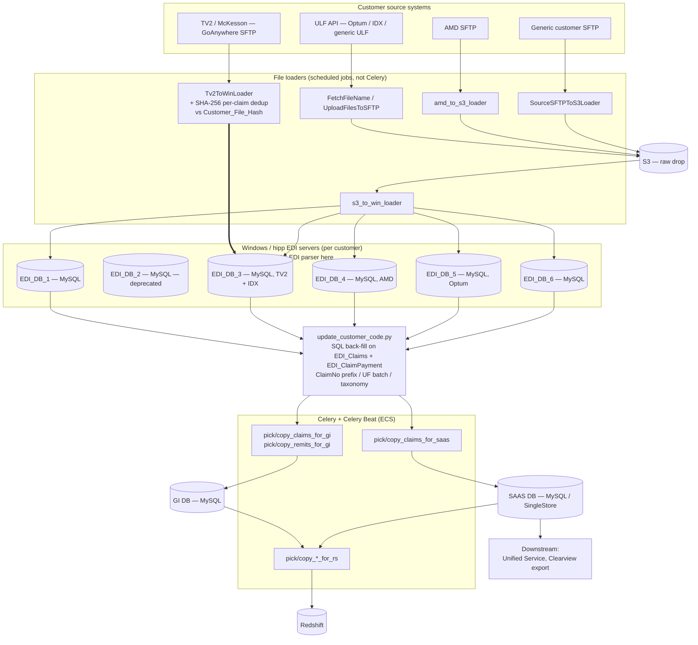
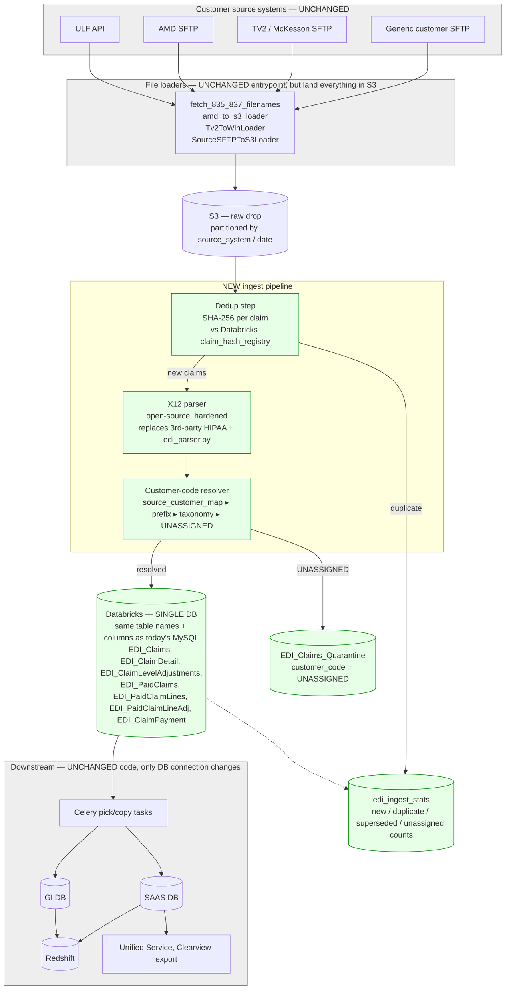
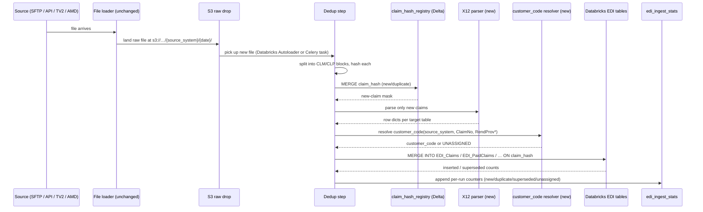
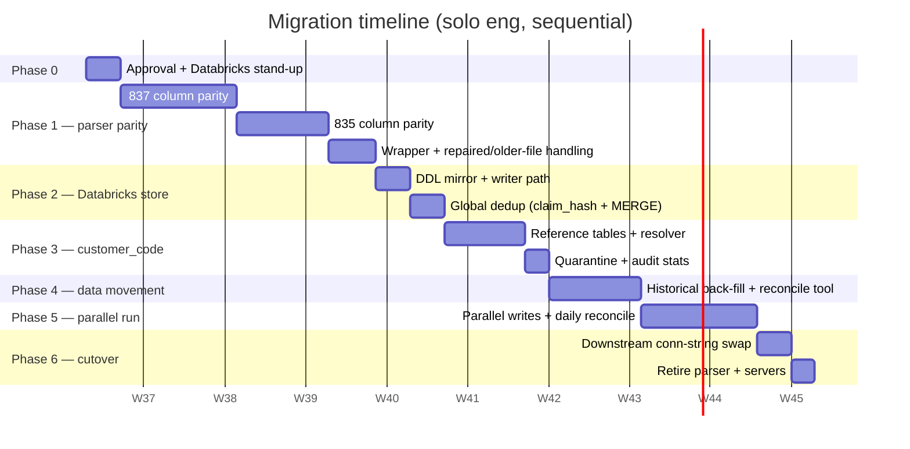

# EDI Pipeline — Current Architecture, Proposed Architecture, and Migration Plan

| Field       | Value |
|-------------|-------|
| **Title**   | Replace HIPAA EDI parser + per-customer MySQL with X12 open-source parser + single Databricks source |
| **Author**  | Deepak / Data Pipeline Team |
| **Status**  | Draft — for review |
| **Created** | 2026-09-09 |

> Scope: replace the HIPAA EDI parser (currently running on per-customer Windows / hipp EDI servers) with an open-source X12 parser, and replace the 6 per-customer MySQL "EDI DBs" with a **single Databricks database** whose schema mirrors today's MySQL exactly.
>
> Everything downstream of the EDI store — Celery pick/copy, GI DB, SAAS DB, Redshift, Unified Service, Clearview export — stays as-is. Only its DB connection changes.
>
> The PoC at `~/Desktop/Work/glide-edi-parser` is referenced **only as sizing evidence** — it demonstrates feasibility of the X12 approach but is not the production artifact. All extraction/parity work is called out explicitly below.

---

## 1. Executive summary

Two changes, nothing else:

1. **New parser.** Retire the HIPAA EDI parser (regex-based, embedded in the Windows / hipp EDI servers plus `edi_parser.py` in this repo). Replace with an open-source X12 parser (Databricks `x12-edi-parser`, hardened for prod — direction proven by the PoC).
2. **New store.** Retire the 6 sharded MySQL EDI DBs (`EDI_DB_1` … `EDI_DB_6`) and consolidate into **one Databricks database** with the same table names and columns as MySQL today.

Two new pieces of engineering fall out of collapsing the per-customer boundary:

- **Dedup must become global** (was implicit inside a single MySQL DB).
- **`customer_code` must be resolved at ingest** (was implicit in which DB was written to).

**Effort estimate:** ~11–13 engineering weeks build + ~2 weeks parallel run ≈ **~13–15 weeks solo** or **~7–8 weeks with 2 engineers in parallel**.

**Highest-risk items:**
- Column-parity gaps in the new parser (silent downstream regressions).
- Customer-code resolver misrouting claims (was previously guaranteed by the DB the loader wrote to).
- Global dedup: correctly telling a *duplicate* apart from a *legitimate re-submission* / *repaired file*, across every customer.

---

## 2. Current architecture

### 2.1 End-to-end flow (as-is)



### 2.2 Key facts (current)

| Aspect            | Current state |
|-------------------|---------------|
| EDI parsing       | 3rd-party HIPAA EDI parser runs on each Windows / hipp EDI server; a lighter regex parser (`edi_parser.py`, ~520 LOC) lives in this repo for TV2's pre-drop hashing and offline error-file investigation. |
| EDI store         | **6 MySQL DBs, one per Windows server**, sharded by customer via `customer_config_customerdatabaseconfig`. Feature flags per customer in `customer_config_customerpipelineconfig`. Env-var config in `Config.databases`. |
| EDI tables (each DB) | `EDI_Claims`, `EDI_ClaimDetail`, `EDI_ClaimLevelAdjustments`, `EDI_PaidClaims`, `EDI_PaidClaimLines`, `EDI_PaidClaimLineAdj`, `EDI_ClaimPayment` |
| Dedup             | **Per-claim SHA-256** at TV2 loader time against `Customer_File_Hash` (per EDI DB). Files older than `Config.edi_file_max_age_days` (548 days) rejected as `OlderDataFileError`. Cross-file dedup then falls out of MySQL uniqueness *within one customer DB*. |
| Customer code     | Implicit in which DB the file was routed to. Explicit column back-filled by `update_customer_code.py` using (a) ClaimNo prefix (`UPDATE_EDI_CLAIMS_SQL`), (b) UF batch, (c) `TAXONOMY_CODE` + `RendProvNPI` lookup (`UPDATE_EDI_CLAIMS_BASED_ON_TAXONOMY`, `UPDATE_EDI_CLAIMPAYMENT_BASED_ON_TAXONOMY`). |
| Known gaps        | 3rd-party HIPAA EDI software sometimes fails to move already-processed files out of its input folder → duplicate rows in `EDI_Claims`/`EDI_ClaimDetail`. No automated dedup at that stage — only manual `Customer_File_Hash` reconciliation. |

### 2.3 What hurts today

- **N Windows boxes to keep alive.** New customer onboarding = new Windows box + new schema + new config wiring.
- **N MySQL DBs to keep alive.** Cross-customer analytics is impossible without ad-hoc joins across shards.
- **Two parsers** (3rd-party HIPAA on Windows + in-house regex in this repo) with different quirks.
- **After-the-fact customer_code back-fill** across 8+ tables per customer — the DB was the source of truth for "who is this?", which is exactly the coupling we want to break.
- **Dedup coverage has a hole** at the 3rd-party parser stage, only visible via manual reconciliation.

---

## 3. Proposed architecture

The new flow removes the Windows / hipp EDI server tier entirely. Files land in S3 (already true for every source except TV2 direct-drop, which is trivial to unify), get deduped against a global hash store, are parsed by the new X12 parser, land in Databricks in the *same table shape as today's MySQL*, and get their `customer_code` resolved at ingest.

### 3.1 Target flow



### 3.2 Stage-by-stage — target

| Stage | What it does | Where it runs | Replaces |
|-------|--------------|---------------|----------|
| **1. Ingest** | Existing file loaders, unchanged. Every source lands into a single S3 layout: `s3://…/raw/{source_system}/{date}/…`. TV2 stops writing directly to `EDI_DB_3`'s Windows server — it just drops to S3 like everything else. | ECS (as today) | — |
| **2. Dedup** | For each file, split into CLM/CLP blocks and compute `SHA256( normalize(block) ‖ ISA13 ‖ source_system )`. MERGE against a Delta table `claim_hash_registry`. Duplicates are recorded and skipped; new claims flow forward. Older-than-548-days check preserved. | Databricks job or Celery task (see §5.4) | TV2 loader's `Customer_File_Hash`, plus the 3rd-party HIPAA server's implicit "already seen" behavior |
| **3. Parse** | X12 parser (open source, hardened) reads the surviving claim blocks and emits row dicts matching the current `EDI_Claims` / `EDI_ClaimDetail` / … column set. | Databricks job (PySpark) or Celery task | 3rd-party HIPAA EDI parser + in-house `edi_parser.py` |
| **4. Resolve customer_code** | For each parsed row, resolve `customer_code` from a priority chain of reference tables. `UNASSIGNED` rows go to a quarantine table. | Same runtime as step 3 | `update_customer_code.py` |
| **5. Land in Databricks** | `MERGE INTO EDI_Claims / EDI_PaidClaims ON claim_hash` — insert new, mark superseded rows on repaired files. Same table names / columns as today's MySQL, plus a small number of ingest-metadata columns (see §4.3). | Databricks | 6 MySQL EDI DBs |
| **6. Downstream** | Celery pick/copy tasks (`pick_claims_for_gi`, `copy_claims_to_saas`, all 6 Redshift pairs) read from Databricks via JDBC / Databricks SQL connector instead of MySQL. No task-logic change. GI DB, SAAS DB, Redshift, Unified Service, Clearview export all unchanged. | ECS (as today) | — |

### 3.3 What actually changes in code

| Component | Change |
|-----------|--------|
| `edi_parser.py` (in-house regex parser) | Retired. Replaced by a wrapper around the new X12 parser that keeps the same call signature so error-investigation tooling in `testing_error/` doesn't rewrite. |
| Windows / hipp EDI servers (all 6) | Decommissioned after cutover. |
| `Config.databases` | 6 MySQL EDI DB entries collapse to 1 Databricks entry. GI DB / SAAS DB / Redshift entries unchanged. |
| `DBEngines.get_engine(..., "mysql_db", customer_code)` | Returns a single Databricks connection regardless of `customer_code`. |
| `pick_claims_for_gi` / `pick_claims_for_saas` / all Redshift picks | No task-logic change. Reads switch from MySQL to Databricks JDBC — same SQL, same batch sizes. `customer_code` is now already populated, so the join/back-fill logic simplifies (see §5.2). |
| `update_customer_code.py` | Superseded by the ingest-time resolver. Kept short-term only for historical back-fill. |
| Table DDLs | Recreated in Databricks with identical names + columns, plus a small ingest-metadata suffix (`claim_hash`, `is_superseded`, `source_system`, `isa_control_number`, `ingest_ts`). |
| Downstream services (GI DB, SAAS DB, Redshift consumers, Unified Service, Clearview export) | No code change. |

---

## 4. Detailed design — the three things that matter

### 4.1 Deduplication (global, across all customers)

**Why it needs new engineering.** Today dedup only needs to be correct *within one customer's MySQL DB*. Once we consolidate, the same claim from the same clearinghouse submitted for the same customer twice must be deduped, but the same claim legitimately submitted for two different customers must NOT be deduped. And a **repaired** file (current parser's `is_repaired` behavior) must replace the older row rather than land as a fresh insert or be rejected as a dup.

**Design.**

- **Hash formula**
  ```
  claim_hash = SHA256(
      normalize(CLM_or_CLP_block)  -- current normalize logic from edi_parser.generate_hash
      || ISA13                     -- interchange control number, disambiguates identical claim segments
      || source_system             -- guards against same-claim-different-customer collision
  )
  ```
  `source_system` (not `customer_code`) is used because dedup runs *before* the customer-code resolver — see stage order in §3.1.

- **Registry**
  A Delta table `claim_hash_registry(claim_hash STRING, source_system STRING, first_seen_ts TIMESTAMP, source_file STRING)`.
  MERGE keyed on `claim_hash` — `WHEN NOT MATCHED THEN INSERT` decides "new vs duplicate".

- **Write path into `EDI_Claims` / `EDI_PaidClaims`**
  `MERGE INTO EDI_Claims USING staged ON claim_hash WHEN NOT MATCHED THEN INSERT`. Databricks Delta doesn't enforce PKs at write time — MERGE is the equivalent of MySQL's `INSERT … ON DUPLICATE KEY IGNORE`.

- **Repaired-file rule** (preserve current parser behavior)
  If a later file yields a *different* hash for the same `(source_system, ClaimNo, ISA13)`, mark the older row `is_superseded = true` rather than delete. Downstream services filter on `is_superseded = false`. This mirrors what today's `is_repaired` handling does implicitly by overwriting inside the single-customer DB.

- **Observability**
  Every ingest run writes counters (`new`, `duplicate`, `superseded`, `older_file_rejected`) to `edi_ingest_stats` keyed by `(source_system, source_file, run_ts)`. This closes the current visibility hole where the 3rd-party HIPAA server occasionally re-processes files and produces duplicate `EDI_Claims`/`EDI_ClaimDetail` rows.

- **Older-file gate**
  Preserved. Any file whose ISA date is older than `Config.edi_file_max_age_days` (548 days) is rejected before dedup and archived to `s3://…/Older_files/`.

**Estimate (dedup, all-up): ~5 eng-days**
- Deterministic per-block `claim_hash` implementation + parity tests against `edi_parser.generate_hash` — 2 days
- `claim_hash_registry` DDL + MERGE writer — 1 day
- Repaired-file supersede rule + tests — 1 day
- `edi_ingest_stats` audit table + emit counters + a small ops dashboard — 1 day

**Dedup risks.**
- Wrong hash inputs → false duplicates (a legitimate re-submission gets swallowed). Mitigated by including ISA13 and source_system, and by requiring the repaired-file rule to explicitly promote/supersede.
- Hash of a rejected/quarantined claim still lands in the registry, blocking a later corrected version → mitigation: only insert into the registry after a *successful* parse & write.
- Registry table grows unbounded. Mitigate with a `first_seen_ts` partition and a 3-year retention (well above the 548-day older-file gate).

### 4.2 Customer-code population (single source of truth)

**Why it needs new engineering.** Today `customer_code` is implicit — the DB you were routed to *is* the answer. `update_customer_code.py` is really just propagating that implicit answer down to the `customer_code` column on `EDI_Claims` and `EDI_ClaimPayment`. Once we go to a single Databricks DB, the implicit answer disappears; the resolver has to derive it explicitly from the file/claim context at ingest.

**Resolver signal chain.** Ordered by determinism — first match wins:

```
customer_code = FIRST_NON_NULL(
    source_customer_map[source_system, sftp_account, file_path_pattern],   -- deterministic, ~95% of files
    claim_prefix_lookup(ClaimNo, claim_prefix_map),                          -- current UPDATE_EDI_CLAIMS_SQL logic
    taxonomy_lookup(RendProvSpecialty, RendProvNPI, taxonomy_map),           -- current TAXONOMY_CODE + RendProvNPI logic
    'UNASSIGNED'                                                              -- routed to quarantine
)
```

**Where the answer comes from at ingest time.** This is the key point — customer identity is *already known* at the loader step for the overwhelming majority of files:

- **ULF** — the loader was configured against a specific ULF customer credential set, so `source_system` + `sftp_account` alone map deterministically to `customer_code`.
- **AMD** — always AMD Healthcare.
- **TV2** — the SFTP folder / GoAnywhere connection is per-TV2-customer.
- **Generic customer SFTP** — same story: one loader config per customer.

That's why the deterministic `source_customer_map` covers ~95%. Prefix and taxonomy lookups are only there to catch the residue (multi-customer clearinghouse drops, edge cases the current pipeline already handles via `update_customer_code.py`).

**Reference tables (all small Delta tables).**

| Table | Populated from | Owner |
|-------|----------------|-------|
| `ref.source_customer_map` | Existing per-customer loader config in `customer_config_customerdatabaseconfig` + `Config.databases` — one row per (source_system, sftp_account, file_path_pattern) → customer_code | Data platform |
| `ref.claim_prefix_map` | The hard-coded `claim_prefix_list` currently passed into `update_customer_code_in_edi` | Data platform |
| `ref.taxonomy_map` | The `TAXONOMY_CODE` constant + the `SELECT_RENDER_PROV_NPI` result set that `update_customer_code.py` uses today | Data platform |

**Quarantine.**
`EDI_Claims_Quarantine` holds `UNASSIGNED` rows for ops review. Today those same rows would silently land in whichever customer DB the loader picked — that's exactly the bug we want to catch instead of ship.

**Can `customer_code` be resolved during parsing?**
The user asked: *is there a way to add customer_code while parsing?* Short answer — **yes, and the design does exactly that**, because the parser is invoked from the ingest task that already knows `source_system` / `sftp_account` (the loader passed them in). The resolver runs immediately after the parser emits row dicts, before the Databricks MERGE. Concretely: the parser doesn't need to know about customer_code (keep it EDI-standard-only, no glide-specific coupling); the calling task attaches `customer_code` to each row from the resolver output before writing. This keeps the X12 parser reusable and testable in isolation.

**Estimate (customer_code, all-up): ~7 eng-days**
- `source_customer_map` seeding from existing config — 1 day
- `claim_prefix_map` extraction + tests against current SQL — 1 day
- `taxonomy_map` extraction + `RendProvNPI` join test — 1 day
- Resolver implementation + unit tests covering every signal path — 2 days
- Quarantine table + review runbook — 1 day
- Parallel-run reconciliation vs `update_customer_code.py` output (mandatory cutover gate) — 1 day

**Customer_code risks.**
- **Highest-risk item in the whole migration.** A wrong answer here misroutes a claim under the wrong customer — downstream services, Clearview export, and Unified Service will all act on wrong data.
- Mitigation: mandatory parallel-run gate. During Phase 5 (see §6), we compare `customer_code` for every row against what `update_customer_code.py` would have produced on MySQL. Block cutover on any mismatch.
- Mitigation: `UNASSIGNED` is an explicit outcome routed to quarantine — never a silent fallback.
- Historical back-fill: `update_customer_code.py` is retained until historical MySQL rows migrated into Databricks have been re-classified, then retired.

### 4.3 Schema — Databricks tables

Same names, same columns as today's MySQL, plus a small ingest-metadata suffix on the two write-target tables:

| Table | Additional columns |
|-------|--------------------|
| `EDI_Claims` | `claim_hash STRING`, `is_superseded BOOLEAN DEFAULT false`, `source_system STRING`, `isa_control_number STRING`, `ingest_ts TIMESTAMP` |
| `EDI_PaidClaims` | same additions |
| everything else (`EDI_ClaimDetail`, `EDI_ClaimLevelAdjustments`, `EDI_PaidClaimLines`, `EDI_PaidClaimLineAdj`, `EDI_ClaimPayment`) | unchanged |

Delta partitioning: `customer_code`, `ingest_date` (needed because volume is cross-customer now, not per-DB).

Auxiliary Delta tables:
- `claim_hash_registry` — dedup source of truth
- `edi_ingest_stats` — per-run counters
- `EDI_Claims_Quarantine` — `UNASSIGNED` rows

---

## 5. Sequence — per-file ingest (target)



Downstream Celery `pick_*` tasks continue to run on their existing 3-minute / 5-minute schedule, but they now poll Databricks tables instead of the 6 MySQL DBs. Same SQL, same batch sizes (1,000 for GI/SAAS, 10,000 for Redshift).

---

## 6. PoC — what exists, what's missing

The PoC at `~/Desktop/Work/glide-edi-parser/glide-health-edi-parser` is a feasibility exercise on top of Databricks' open-source `x12-edi-parser`. It is **not the production artifact** — the user has been explicit about this. It's referenced here only to size remaining work.

### What the PoC already demonstrates

- Transaction detection for **221 (835)**, **222 (837P)**, **223 (837I)** — see `parser.py:parse_edi_file_auto`.
- Structured extraction of: submitter, receiver, subscriber, patient, payer, providers (billing / rendering / attending / service-facility), diagnosis codes, claim header, service lines (via `HealthcareManager.flatten` and `flatten_remits`).
- PySpark entry point (`parse_edi_spark`) with S3 read/write plumbing — useful, but *not* required for this RFC's design if we run inside Celery instead.
- End-to-end file-in, JSON-out on the sample files under `sample_files/` — proves the approach.

### What is NOT yet in the PoC (all in scope of this RFC)

| Gap | Why it matters | Rough effort |
|-----|----------------|--------------|
| Not all columns needed by `EDI_Claims` / `EDI_ClaimDetail` / `EDI_ClaimLevelAdjustments` / `EDI_PaidClaims` / `EDI_PaidClaimLines` / `EDI_PaidClaimLineAdj` / `EDI_ClaimPayment` are extracted yet. | Any missing column silently breaks a downstream consumer. | See §7 items 1–2 (18 days total) |
| Claim-level and line-level adjustment (CAS) parity — segments today feed `EDI_ClaimLevelAdjustments` / `EDI_PaidClaimLineAdj`. | Financial reconciliation depends on these. | Included in §7 item 1–2 |
| Deterministic per-block hash matching `edi_parser.generate_hash`. | Required for global dedup. | §7 item 4 (2 days) |
| Customer-code resolver — doesn't exist in the PoC. | Blocking. | §7 item 8 (4 days) |
| Non-Spark, drop-in-replacement wrapper matching current `EDIParser` call signature. | Keeps `testing_error/` tooling and Celery entrypoints stable. | §7 item 3 (4 days) |
| `is_repaired` / `is_older_file` detection currently in `edi_parser.py`. | Preserves current supersede + rejection behavior. | Included in §7 item 3 |
| Quarantine flow + audit stats + error handling for prod. | Required. | §7 items 9, 11 (6 days total) |
| Regression tests against outputs from the current parser on a fixed corpus. | Only way to prove parity before cutover. | §7 item 13 (4 days) |

---

## 7. Effort estimates

| # | Workstream | Effort (eng-days) | Risk |
|---|------------|-------------------|------|
| 1 | 837 column parity — every field needed on `EDI_Claims`, `EDI_ClaimDetail`, `EDI_ClaimLevelAdjustments` | **10** | Med |
| 2 | 835 column parity — every field needed on `EDI_PaidClaims`, `EDI_PaidClaimLines`, `EDI_PaidClaimLineAdj`, `EDI_ClaimPayment` | **8** | Med |
| 3 | Drop-in wrapper matching `EDIParser` call signature + port `is_repaired` / `is_older_file` handling | **4** | Low |
| 4 | Deterministic per-block `claim_hash` (parity with `edi_parser.generate_hash`) | **2** | Low |
| 5 | Databricks DDL mirroring MySQL exactly + `DBEngines` writer path (Databricks JDBC / SQL connector) | **3** | Low |
| 6 | Global dedup — `claim_hash_registry` + MERGE into `EDI_Claims` / `EDI_PaidClaims` + supersede rule | **3** | Med |
| 7 | Reference tables (`source_customer_map`, `claim_prefix_map`, `taxonomy_map`) + seeding from existing config | **3** | Low |
| 8 | **Customer-code resolver** in the ingest step | **4** | **High** — misroutes claims if wrong |
| 9 | Quarantine table + ops review runbook + `edi_ingest_stats` audit dashboard | **2** | Low |
| 10 | Historical back-fill from 6 MySQL EDI DBs → Databricks (respect `claim_hash` + `customer_code`) | **4** | Med |
| 11 | Row-level reconciliation tool (MySQL vs Databricks) — mandatory cutover gate | **4** | Med |
| 12 | Downstream conn-string swap (GI DB / SAAS DB / Redshift picks) + smoke tests | **3** | Low |
| 13 | Regression test corpus vs current parser output | **4** | Low (gate) |
| 14 | Decommission — retire `edi_parser.py`, retire `update_customer_code.py`, freeze then turn off Windows / hipp EDI servers | **2** | Low |
| **Total** | | **~56 eng-days ≈ 11 weeks** | |

Add **~10 eng-days (~2 weeks) buffer** for parallel-run drift and reconciliation fixes.

- **Solo:** ~13–15 weeks.
- **With 2 engineers in parallel:** ~7–8 weeks. Items #1, #2, #5 parallelize cleanly; #7 + #8 pair well (same person owns customer_code end-to-end).

### Effort estimates called out separately by feature (as requested)

| Feature | Effort |
|---------|--------|
| **Dedup pipeline** (items #4 + #6 + #9's stats portion) | **~6 eng-days ≈ 1.2 weeks** |
| **Customer-code population** (items #7 + #8 + #9's quarantine portion + parallel-run reconciliation) | **~10 eng-days ≈ 2 weeks** |
| **X12 parser productionization** (items #1 + #2 + #3 + #13) | **~26 eng-days ≈ 5–6 weeks** |
| **Databricks store + writer + downstream conn swap** (items #5 + #10 + #11 + #12) | **~14 eng-days ≈ 3 weeks** |
| **Cutover + decommission** (item #14) | **~2 eng-days** |

---

## 8. Migration plan (phased)



| Phase | Scope | Duration |
|-------|-------|----------|
| **0** | Approve, freeze Databricks DDL (mirror MySQL), provision workspace + SQL warehouse | 0.5 wk |
| **1** | Take PoC, close column-parity gaps for 837 + 835, wrap for drop-in call signature, port repaired/older-file detection | 4.5 wk |
| **2** | Create Databricks tables (identical schema + ingest-metadata additions), swap `DBEngines` writer path, add `claim_hash` MERGE + supersede rule | 1.5 wk |
| **3** | Build customer-code resolver, seed reference tables, wire quarantine + audit stats | 2 wk |
| **4** | Back-fill historical MySQL data into Databricks, build row-level reconciliation tool | 2 wk |
| **5** | Parallel-run: both MySQL and Databricks receive writes; reconcile daily; fix drift; **customer_code parity is the hard gate** | 2 wk |
| **6** | Point downstream (GI/SAAS/Redshift picks) at Databricks, freeze MySQL read-only for 30 days, decommission Windows/hipp EDI servers + in-house parser | 1 wk |

**Total: ~13.5 build weeks + ~2 parallel-run weeks = ~15 weeks solo.**

---

## 9. Risks & mitigations

| Risk | Impact | Mitigation |
|------|--------|------------|
| New X12 parser silently misses a column | Downstream regression, potentially hidden for weeks | Item #13 — regression test corpus comparing every column of new-parser output against current-parser output on a fixed sample of files. Gate cutover on 100% parity on the sample. |
| Global dedup marks a legitimate re-submission as duplicate | Missing claim in Redshift / Clearview export | `claim_hash` includes ISA13 + source_system; supersede-flag flow instead of hard delete; explicit repaired-file rule preserves current behavior. |
| Global dedup fails to catch a duplicate | Duplicated claim rows downstream (current known gap on the 3rd-party parser stage) | Every file goes through the hash registry — no bypass. `edi_ingest_stats` gives ops visibility that today's pipeline lacks. |
| Customer-code resolver misroutes a claim | **Highest-blast-radius risk in the migration** — wrong customer_code corrupts SAAS DB, Unified Service, Clearview export | Deterministic `source_customer_map` covers ~95% (loader already knows the customer); prefix + taxonomy replicate current `update_customer_code.py` logic exactly; `UNASSIGNED` quarantine on ambiguity; **mandatory parallel-run reconciliation** vs `update_customer_code.py` output; block cutover on any mismatch. |
| Quarantine backlog grows unbounded | Ops overhead | SLA on quarantine review (open question #3 in §11); dashboard on `EDI_Claims_Quarantine` count; alert threshold. |
| Databricks JDBC latency for point-lookups used by Celery pick tasks | Pipeline throughput drop vs MySQL | Use Databricks SQL Warehouse (not general-purpose cluster); if a specific pick task is latency-sensitive, materialize a small read-replica of just its slice into MySQL (last-resort fallback). |
| Historical back-fill drifts from live writes during Phase 4/5 | Row counts don't reconcile | Freeze back-fill cutoff timestamp; live pipeline writes to *both* MySQL and Databricks during Phase 5; reconcile against the timestamp boundary only. |
| PoC parser gets rewritten mid-project | Slippage | Scoped up front — PoC informs sizing only; production parser is a hardened re-implementation. Line items #1–#4 already assume this. |
| Windows/hipp EDI server decommission takes down TV2 mid-migration | Data loss / support fire | Windows servers stay live in read-only mode through Phase 5; only decommissioned in Phase 6 after downstream cutover succeeds. |
| Two parsers producing subtly different `EDI_ClaimDetail` rows | Silent parity drift | Same regression corpus (item #13) run in CI on every parser change during Phase 1. |

---

## 10. Alternatives considered

| Option | Verdict |
|--------|---------|
| Swap only the parser, keep per-customer MySQL | Rejected — leaves Windows-box-per-customer pain, blocks cross-customer analytics, doesn't unlock the customer_code / dedup rewrite. |
| Swap only the DB, keep in-house parser + 3rd-party HIPAA | Rejected — parser is the more brittle side, and we'd still be maintaining two of them. |
| Adopt a commercial X12 parser (Edifecs etc.) | Rejected for now — cost + lock-in. PoC shows open-source is workable. Revisit only if parity work in Phase 1 slips badly. |
| Rebuild as medallion (bronze/silver/gold lakehouse) | Rejected — out of scope. This RFC is a like-for-like swap. Medallion could come later on top of a single Databricks DB. |
| Do dedup after parsing (traditional per-row uniqueness) | Rejected — wastes parser cycles on known duplicates, and provides less deterministic replay than block-hash dedup. |

---

## 11. Open questions

1. Single Databricks DB, or Unity Catalog schema-per-customer for audit/compliance isolation?
2. Which downstream service is the pilot for the Phase 6 conn-string swap? (Recommend the SAAS pick tasks, since GI is more central.)
3. SLA for `UNASSIGNED` quarantine review — same-day, next-day, weekly?
4. Historical back-fill scope — all history, or only last N months? (Older-file gate is 548 days, so back-fill beyond that is dead weight for live ingest but might matter for analytics.)
5. Do we retire `update_customer_code.py` fully once the resolver is live, or keep it as a nightly reconciliation safety net?
6. Does the parser run inside the existing Celery task, or as a Databricks Autoloader job triggered by S3 landing? (Design supports either — see §5.4-adjacent language in §3.2; recommendation: Databricks Autoloader for scale, Celery task only as a fallback if we hit Databricks quota / cold-start issues.)

---

## 12. Rollout & rollback

- **Rollout:** Databricks receives writes in Phase 5 in parallel with MySQL. Downstream services are cut over one at a time in Phase 6, gated on reconciliation reports. Windows / hipp EDI servers stay live through the end of Phase 5.
- **Rollback:** flip the downstream conn string back to MySQL — 1 config change per service. Because MySQL keeps receiving writes through Phase 5, rollback in Phase 5 or the first days of Phase 6 is a config change, not a re-migration.
- **Point of no return:** end of Phase 6, when the in-house parser is turned off and Windows servers are decommissioned. Keep MySQL read-only for 30 days after that.

---

## 13. Appendix — file references

**Current pipeline (kept, only internals swap):**
- Parser to be replaced: `glide-health-data-pipeline-v2/src/scripts/async_tasks/tasks_utils/edi_utils/edi_parser.py`
- Customer-code back-fill (to be superseded): `glide-health-data-pipeline-v2/src/scripts/async_tasks/tasks_utils/edi_utils/update_customer_code.py`
- DB engine + config: `glide-health-data-pipeline-v2/src/common/db_engine.py`, `glide-health-data-pipeline-v2/src/common/config.py` (`Config.databases`, lines 269–312 define the EDI tables)
- SQL templates today: `glide-health-data-pipeline-v2/src/scripts/async_tasks/tasks_utils/sql_utils.py`
- Celery tasks: `glide-health-data-pipeline-v2/src/scripts/async_tasks/tasks.py`
- Celery Beat schedule: `glide-health-data-pipeline-v2/src/scripts/async_tasks/beat_schedule.py`
- File loaders: `glide-health-data-pipeline-v2/src/scripts/file_loaders/`
- End-to-end pipeline overview (context for anyone reading this doc cold): `README.md` at repo root

**PoC (reference for sizing only — not the production artifact):**
- `~/Desktop/Work/glide-edi-parser/glide-health-edi-parser/src/edi_parser/parser.py` — `parse_edi_file_auto`, `parse_edi_spark`
- `~/Desktop/Work/glide-edi-parser/glide-health-edi-parser/src/edi_parser/x12/` — vendored X12 EDI segment logic
- `~/Desktop/Work/glide-edi-parser/glide-health-edi-parser/sample_files/` — sample 837 / 835 files the PoC has been validated against

---

## 14. Approval

| Role | Name | Decision | Date |
|------|------|----------|------|
| Data Platform Lead |  |  |  |
| Downstream Services Lead |  |  |  |
| Ops Lead |  |  |  |
| Engineering Manager |  |  |  |
